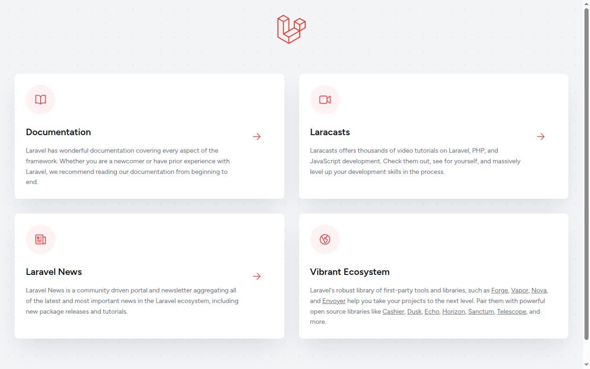

# Backend Laundry Laravel

Backend REST API untuk aplikasi laundry Di Laundry. API ini dibangun dengan Laravel 10 dan Laravel Sanctum. Data utama yang dikelola adalah pengguna, toko laundry, promo, dan pesanan laundry. Repositori ini adalah sisi server dari aplikasi flutter-frontend-laundry.

## Fitur

- Registrasi dan login pengguna dengan token Sanctum
- Daftar toko laundry, promo, pengguna, dan pesanan laundry tanpa login
- Daftar promo dengan batas lima data untuk pengguna yang sudah login
- Rekomendasi toko berdasarkan rating tertinggi
- Pencarian toko berdasarkan nama kota
- Daftar pesanan laundry berdasarkan pengguna
- Pembuatan pesanan laundry baru oleh pengguna yang sudah login
- Klaim pesanan laundry dengan kode klaim
- Seeder berisi contoh data pengguna, toko, promo, dan pesanan

## Endpoint API

Endpoint publik:

| Method | Endpoint | Keterangan |
| --- | --- | --- |
| GET | `/api/promo` | Semua promo |
| GET | `/api/shop` | Semua toko laundry |
| GET | `/api/laundry` | Semua pesanan laundry |
| GET | `/api/user` | Semua pengguna |
| POST | `/api/register` | Registrasi pengguna baru |
| POST | `/api/login` | Login dan menerima token |

Endpoint yang memerlukan login dengan token Sanctum:

| Method | Endpoint | Keterangan |
| --- | --- | --- |
| GET | `/api/promo/limit` | Lima promo pertama |
| GET | `/api/shop/recommendation/limit` | Toko dengan rating tertinggi |
| GET | `/api/shop/search/city/{name}` | Cari toko berdasarkan kota |
| GET | `/api/laundry/user/{id}` | Pesanan milik satu pengguna |
| POST | `/api/laundry` | Buat pesanan laundry baru, kode klaim dibuat otomatis dan status awal Queue |
| POST | `/api/laundry/claim` | Klaim pesanan laundry |

## Teknologi

- PHP 8.1 atau lebih baru
- Laravel 10
- Laravel Sanctum untuk autentikasi token
- MySQL sebagai database bawaan, dapat diganti SQLite

## Cara Instalasi

Prasyarat:

- PHP 8.1 atau lebih baru
- Composer
- MySQL, atau SQLite bila ingin menjalankan tanpa server database

Langkah instalasi:

```bash
git clone https://github.com/bintangyudhis/laravel-backend-laundry.git
cd laravel-backend-laundry
composer install
cp .env.example .env
php artisan key:generate
```

Atur koneksi database di file `.env`. Untuk MySQL, isi `DB_DATABASE`, `DB_USERNAME`, dan `DB_PASSWORD`. Untuk SQLite, ubah `DB_CONNECTION` menjadi `sqlite` dan buat file database kosong:

```bash
touch database/database.sqlite
```

Lalu jalankan migration dan seeder:

```bash
php artisan migrate --seed
```

## Cara Menjalankan

Jalankan server pengembangan Laravel:

```bash
php artisan serve
```

API dapat diakses mulai dari `http://localhost:8000/api`. Contohnya, daftar toko ada di `http://localhost:8000/api/shop`.

## Tangkapan Layar

Halaman akar aplikasi ini adalah halaman sambutan Laravel. Layanan utamanya berupa API JSON pada endpoint yang tercantum di atas.



## Lisensi

Proyek ini memakai lisensi MIT. Lihat berkas [LICENSE](LICENSE) untuk teks lengkapnya.
